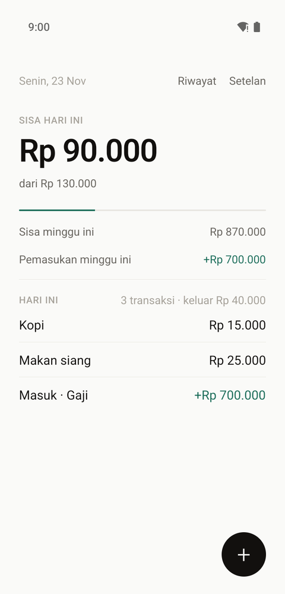
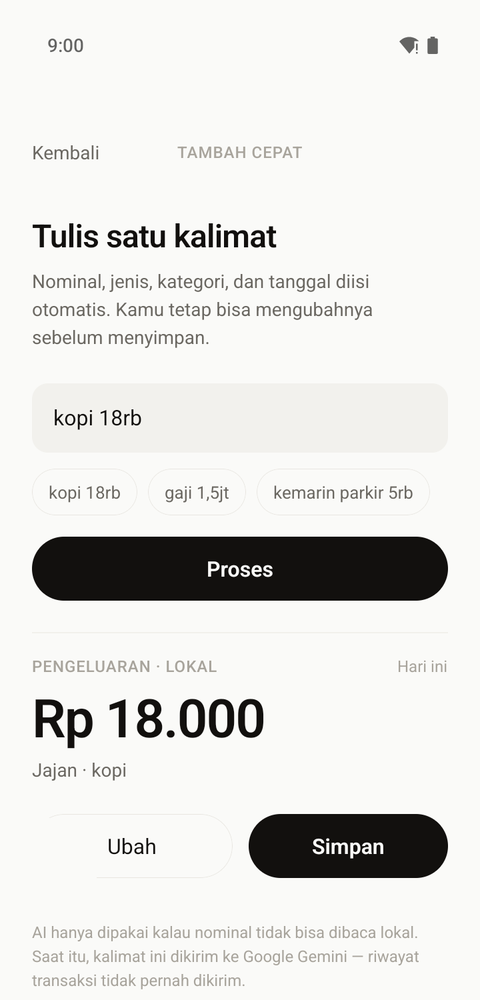
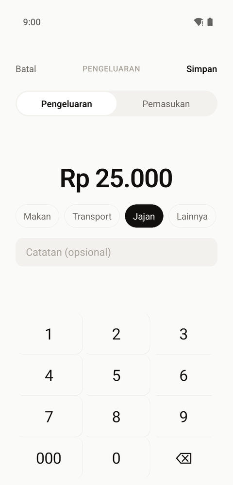
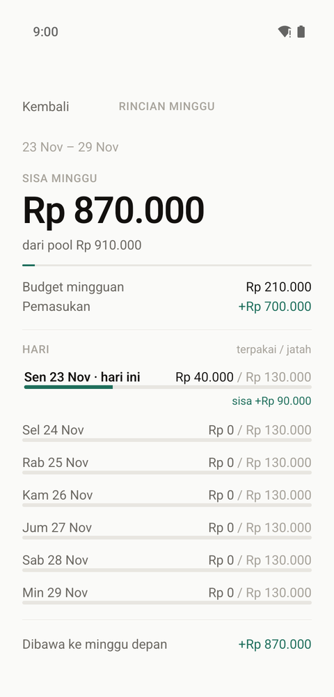
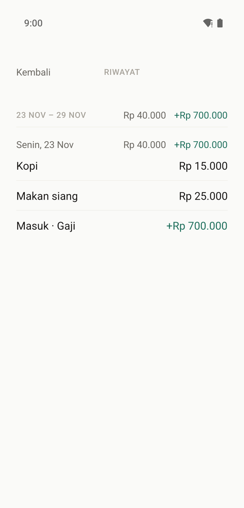

# Avaln Kas

App budgeting pribadi untuk Android dengan **rolling budget**: sisa budget hari ini
terbawa ke besok, sisa minggu terbawa ke minggu depan — termasuk saat minus
(debt mode), dengan batas bawah supaya tidak spiral.

Offline penuh. Tanpa login, tanpa backend, tanpa cloud sync. Data tersimpan di
SQLite device, backup lewat file JSON.

> Status: **prototype**. Batch A + B selesai (fondasi, rolling budget, DB v3,
> onboarding, tambah/edit, riwayat, setelan, backup). AI menyusul.

<p align="center">
  
  
  
  
  
</p>

## Fitur

- **Rolling budget** harian dan mingguan, mode debt + `debt_floor`
- **Dark mode** — ikut sistem atau pilih Terang/Gelap; palet charcoal, bukan hitam pekat
- **Tambah cepat** — tulis “kopi 18rb” atau “kemarin parkir 5rb”; parser lokal jalan
  offline, AI Gemini opsional untuk kalimat bebas
- **Pengeluaran & pemasukan** — pemasukan menambah pool minggu berjalan
- **Onboarding** — atur budget mingguan & awal minggu saat pertama pakai
- **Rincian minggu** — 7 hari: jatah, terpakai, carry, dan rollover ke minggu depan
- **Riwayat** dikelompokkan per minggu → hari, tap untuk ubah/hapus
- **Kategori** bisa ditambah/dihapus
- **Backup** export/import JSON dengan validasi
- **Tutup minggu otomatis** — minggu lewat dibekukan, rollover dihitung ulang
- Uang selalu **integer rupiah** (tanpa float), format manual tanpa `Intl`

## Cara kerja angkanya

```
pool        = weeklyBudget + income + rolloverIn
dailyBase   = pool / 7, dibulatkan ke 500 (sisa ke hari ke-7)
available   = base hari itu + carry dari hari sebelumnya
carryOut    = available − spent
rolloverOut = clamp(pool − spentTotal, debtFloor, ∞)
```

Contoh: pool 210.000 → jatah 30.000/hari. Senin belanja 22.000 → Selasa punya
38.000. Selasa belanja 45.000 → Rabu punya 23.000, dan seterusnya.

## Stack

- Expo SDK 58 · React Native 0.88 · TypeScript (strict)
- expo-router · expo-sqlite · expo-secure-store (API key AI) · Gemini Flash (opsional)
- Vitest untuk logika murni

## Menjalankan

```bash
npm install
npx expo start --lan
```

Buka **Expo Go** di HP (satu WiFi) lalu scan QR. Untuk emulator Android:

```bash
# Android SDK + AVD diperlukan
emulator -avd <nama-avd> -gpu swangle -feature -Vulkan -cores 4 &
adb reverse tcp:8081 tcp:8081
adb shell am start -a android.intent.action.VIEW -d "exp://127.0.0.1:8081"
```

Web **tidak didukung** — `expo-sqlite` di web butuh wasm + header COOP/COEP,
dan target app ini native.

## Install APK

APK rilis (universal, ±102 MB) tersedia di
[Releases](https://github.com/Avalntinus/avaln-kas/releases).

Atau build sendiri — butuh JDK 21 + Android SDK (lihat [BUILD.md](BUILD.md)).

## Perintah

```bash
npm test            # 47 unit test (rollover, perencana minggu, validator backup)
npm run typecheck   # tsc --noEmit
npm run lint        # expo lint
npx expo export --platform android --output-dir dist-check
```

## Struktur

```
src/app/            route expo-router (index, welcome, add, history, settings)
src/logic/          rollover.ts (inti), weeks.ts, weeks-planner.ts
src/db/             schema + migrasi, singleton koneksi, repo query
src/ui/             komponen presentasional (screen, meter, money-pad, ...)
src/lib/            money, date, backup, labels
src/features/home/  hook data Home
src/theme/          token warna/spacing/tipografi
```

Aturan kontribusi/agent ada di [`AGENTS.md`](AGENTS.md). Ringkasnya: uang integer,
tanggal `YYYY-MM-DD`, logika rollover tetap murni, warna hanya dari token.

## Data & privasi

- Tidak ada request jaringan untuk fungsi inti.
- Database lokal `budgeting.db` di sandbox app.
- Backup JSON berisi transaksi, kategori (nama), dan setelan — tidak ada kredensial.
- API key Gemini disimpan di `expo-secure-store` (Android Keystore), tidak ikut backup.
- AI hanya dipakai kalau parser lokal gagal. Yang dikirim hanya **kalimat yang kamu
  ketik**, nama kategori, dan tanggal hari ini — riwayat transaksi tidak pernah dikirim.

## Roadmap

- [x] Ikon aplikasi (paper + emerald, monogram A + meter)
- [x] Screenshot di README
- [x] Tambah cepat (parser lokal, offline)
- [x] Integrasi Gemini Flash (opsional, key di SecureStore, output divalidasi)
- [x] Layar rincian minggu (7 hari + carry)
- [x] Dark mode (System / Terang / Gelap)
- [x] Build APK rilis (keystore sendiri, standalone tanpa Metro)
- [ ] Aktifkan AI dengan API key pribadi

## Lisensi

MIT — lihat [LICENSE](LICENSE).
